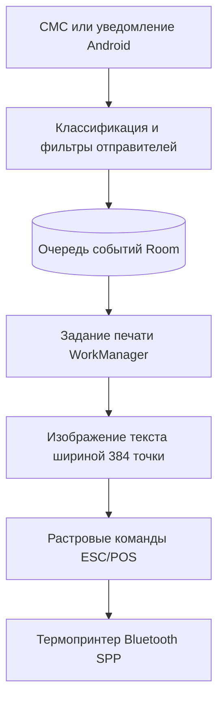

# NotiPrint

[English version](README.md)

NotiPrint сохраняет входящие СМС, пропущенные звонки и уведомления календаря на Android-телефоне, затем печатает их на термопринтере по Bluetooth. Крупный текст на бумаге помогает близкому человеку получить важное сообщение, не открывая приложение.

Подходящие события попадают в локальную базу до печати. Очередь сохраняется после перезапуска, накапливает задания ночью и повторяет отправку, когда принтер выключен или вне зоны связи. Данные событий остаются на телефоне.



## Инженерные решения

- **Сохранение до отправки.** [Room](app/src/main/java/ru/notiprint/data/PrintJobDao.kt) хранит содержимое события и статус печати. При сбое принтера задание остаётся в очереди; прерванные задания возвращаются в неё при следующем запуске. WorkManager назначает немедленную печать, утренний запуск и отложенные попытки.
- **Общая блокировка восстановления и печати.** [Блокировка корутин](app/src/main/java/ru/notiprint/printer/PrinterConnectionGate.kt) охватывает восстановление очереди, выбор заданий, печать и запись ошибки. Её используют все обработчики очереди (workers) и ручная проверка принтера. Второй обработчик не может вернуть в очередь задание, которое первый ещё отправляет.
- **Подготовка изображения до передачи.** Приложение рисует кириллицу на [изображении шириной 384 точки](app/src/main/java/ru/notiprint/printer/NotificationBitmapRenderer.kt), поэтому кодовая страница принтера не влияет на текст. [Растровые полосы ESC/POS](app/src/main/java/ru/notiprint/printer/EscPosRasterEncoder.kt) поступают по одному соединению Bluetooth Classic Serial Port Profile (SPP) без пауз между полосами. После каждого чека приложение сбрасывает буфер потока и выдерживает расчётную паузу на допечатку.

В приложении есть настройка ночного интервала, локальный чёрный список отправителей, фильтр СМС с незнакомых числовых номеров и диагностическая страница. При включённом фильтре неизвестных номеров буквенные метки отправителей, например `МЧС`, остаются допустимыми.

## Быстрый запуск

Для сборки нужны JDK 17 и Android SDK Platform 35. Для печати — телефон с Android 8.0+ и сопряжённый термопринтер Bluetooth Classic SPP под бумагу 58 мм, с растровой печатью ESC/POS шириной 384 точки (`GS v 0`). Среди таких моделей — MUNBYN IMP006.

```bash
./gradlew :app:assembleDebug
adb install -r app/build/outputs/apk/debug/app-debug.apk
```

В Windows команда сборки — `.\gradlew.bat :app:assembleDebug`. APK также можно скопировать на телефон и открыть через файловый менеджер.

При первом запуске в приложении выбирается ранее сопряжённый принтер, выдаются запрошенные разрешения и доступ к уведомлениям. Кнопка **«Тестовая печать»** проверяет соединение и качество отпечатка. Настройки фоновой работы и автозапуска зависят от производителя телефона. Ночной интервал по умолчанию — **22:00–08:00**.

## Проверки

```bash
./gradlew :app:testDebugUnitTest :app:lintDebug :app:assembleDebug :app:assembleRelease
./gradlew :app:connectedDebugAndroidTest
```

Локальная проверка завершилась успешно: **21 JVM-тест**, Android lint и сборки debug- и оптимизированного release-APK. Тесты охватывают классификацию уведомлений, расчёт ожидания принтера, ночные интервалы, задержки повторов и сценарии очереди.

APK тестов Android также собирается локально. Его **пять инструментальных тестов** проверяют сохранение данных Room и планирование WorkManager, в том числе обработку 120 событий тремя обработчиками. Для этих тестов настроено отдельное задание CI на API 35; вторая команда выше требует запущенного эмулятора или подключённого телефона.

В [GitHub Actions](https://github.com/mzaprudin/notiprint/actions) доступны отчёты сборки и APK в артефактах. Оба варианта сборки используют локальный debug-keystore; установка обновления требует того же ключа подписи. [Раздел о подписи и установке](docs/DEVELOPMENT.RU.md#подпись-и-установка-apk) объясняет, как это влияет на локальные сборки и CI.

## Документация

- [Архитектура](docs/ARCHITECTURE.RU.md): обработка событий, восстановление очереди, повторные попытки и растровая печать.
- [Разработка и эксплуатация](docs/DEVELOPMENT.RU.md): сборка, разрешения, установка, диагностика принтера и проверки на устройстве.

Лицензия — [MIT](LICENSE).
