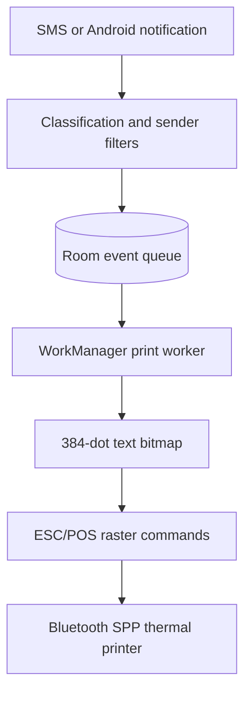

# NotiPrint

[Русская версия](README.RU.md)

NotiPrint saves incoming SMS, missed calls, and calendar notifications on an Android phone, then prints them on a Bluetooth thermal printer. Large text on paper lets a family member receive an important message without opening the app.

Accepted events enter a local database before printing. The queue survives a restart, waits through the night interval, and retries when a printer is switched off or out of range. Event data stays on the phone.



## Engineering decisions

- **Save before sending.** [Room](app/src/main/java/ru/notiprint/data/PrintJobDao.kt) stores event content and print status. Printer failures leave work in the queue; interrupted jobs return to it on the next run. WorkManager schedules immediate, morning, and delayed retry work.
- **Serialize recovery with printing.** A shared [coroutine lock](app/src/main/java/ru/notiprint/printer/PrinterConnectionGate.kt) covers queue recovery, job selection, printing, and failure updates. All worker chains and the manual test use this lock, so a second worker cannot reclaim a job while the first sends it.
- **Render text before transport.** The app renders Cyrillic as a [384-dot bitmap](app/src/main/java/ru/notiprint/printer/NotificationBitmapRenderer.kt), avoiding printer code-page settings. [ESC/POS raster bands](app/src/main/java/ru/notiprint/printer/EscPosRasterEncoder.kt) go over one Bluetooth Classic Serial Port Profile (SPP) connection without pauses between bands; each receipt ends with a flush and an estimated wait for the printer to finish.

The app also includes a configurable night interval, a local sender blacklist, an option to ignore SMS from unknown numeric senders, and a diagnostic print page. Alphabetic Sender IDs such as `МЧС` remain eligible when the unknown-number filter is enabled.

## Quick start

Requirements: JDK 17, Android SDK Platform 35, an Android 8.0+ phone, and a paired 58 mm Bluetooth Classic SPP printer with 384-dot ESC/POS raster support (`GS v 0`), such as the MUNBYN IMP006.

```bash
./gradlew :app:assembleDebug
adb install -r app/build/outputs/apk/debug/app-debug.apk
```

On Windows, the build command is `.\gradlew.bat :app:assembleDebug`. An APK can also be copied to the phone and opened from its file manager.

On first launch, select an already paired printer, grant the requested permissions and notification access, then run **Тестовая печать** (Test print). Background operation and autostart settings depend on the phone manufacturer. The default night interval is **22:00–08:00**.

## Verification

```bash
./gradlew :app:testDebugUnitTest :app:lintDebug :app:assembleDebug :app:assembleRelease
./gradlew :app:connectedDebugAndroidTest
```

Local verification passed **21 JVM tests**, Android lint, and both debug and optimized release builds. The tests cover notification classification, printer timing, night intervals, retry backoff, and queue scenarios.

The Android test APK also builds locally. Its **five instrumented tests** cover Room persistence and WorkManager scheduling, including 120 queued events drained by three workers. The API 35 CI job runs these tests; the second command above requires a running emulator or connected phone.

[GitHub Actions](https://github.com/mzaprudin/notiprint/actions) provides build reports and APK artifacts. Both build variants use the local debug keystore; installing an update requires the same signing key. [Signing and installation details](docs/DEVELOPMENT.md#apk-signing-and-installation) explain how this affects local and CI builds.

## Documentation

- [Architecture](docs/ARCHITECTURE.md): event handling, queue recovery, retry scheduling, and raster printing.
- [Development and operation](docs/DEVELOPMENT.md): builds, permissions, installation, printer diagnostics, and device checks.

Licensed under [MIT](LICENSE).
