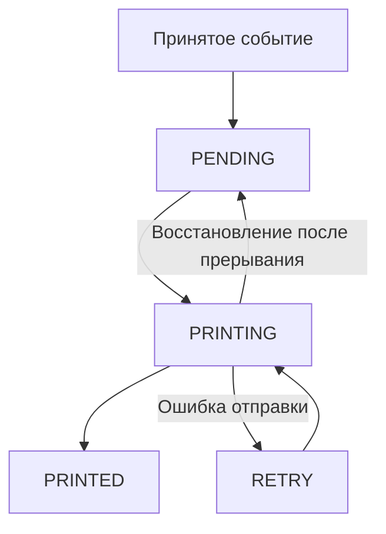

# Архитектура

[English version](ARCHITECTURE.md) · [Обзор проекта](../README.RU.md)

NotiPrint разделяет приём событий и печать. Получатели событий записывают данные в Room, а WorkManager запускает обработчик очереди (worker). Общая блокировка согласует соединения с принтером и связанные с ними изменения статусов в базе.

## Приём событий и локальное хранение

[SmsReceiver](../app/src/main/java/ru/notiprint/receivers/SmsReceiver.kt) получает СМС напрямую от Android и объединяет части длинных сообщений. Он проверяет чёрный список и фильтр неизвестных номеров, находит имя контакта при наличии разрешения, затем сохраняет событие. Фильтр неизвестных номеров пропускает буквенные метки отправителей.

[NotiPrintNotificationListenerService](../app/src/main/java/ru/notiprint/notifications/NotiPrintNotificationListenerService.kt) обрабатывает пропущенные звонки и события календаря. Если разрешение на прямой приём СМС недоступно, сервис также принимает уведомления СМС-приложений. Классификатор использует категории Android; для пропущенных звонков дополнительно проверяет пакет телефонного приложения, канал и текст уведомления. Собственные уведомления и сводки групп пропускаются.

После повторного подключения слушателя сервис просматривает активные уведомления: так он подхватывает подходящие события, которые ещё находятся в шторке. Мьютекс последовательно выполняет проверку повтора и вставку. Обновления календаря с тем же ключом уведомления и содержимым в пределах минуты отбрасываются. У каждого сохранённого события также есть уникальный ключ источника; Room игнорирует повторную вставку с этим ключом.

[PrintJob](../app/src/main/java/ru/notiprint/data/PrintJob.kt) хранит ключ источника, тип события, заголовок, текст, пакет приложения, время, статус, счётчик повторов и последнюю ошибку. В базе также находится чёрный список отправителей. Настройки и состояние задержки повторов хранятся в SharedPreferences. Приложение не запрашивает доступ в Интернет; резервное копирование Android отключено.

## Очередь и доступ к принтеру

[Очередь](../app/src/main/java/ru/notiprint/data/PrintJobDao.kt) выбирает строки `PENDING` и `RETRY` по времени получения, до 50 за один запуск обработчика. Если после успешной партии задания ещё есть, назначается следующий немедленный запуск.

[PrinterConnectionGate](../app/src/main/java/ru/notiprint/printer/PrinterConnectionGate.kt) содержит общий для процесса `Mutex` корутин. Перед работой с принтером его захватывают ручная диагностика и все обработчики: немедленные, повторные и утренние.

Обработчик удерживает блокировку во время восстановления, выбора заданий, соединения и отправки всей партии. Перед выбором он возвращает оставшиеся строки `PRINTING` в `PENDING`. Каждое задание получает статус `PRINTING` до подготовки изображения и отправки, а после успешной отправки — `PRINTED`. При ошибке статус `RETRY`, число повторов и текст ошибки записываются до освобождения блокировки. Следующий обработчик видит итоговый статус предыдущей попытки.

Этот порядок позволяет восстановить прерванную работу и сохранить статус задания, которое другой обработчик ещё печатает. Блокировка согласует обработчики внутри процесса приложения; Room сохраняет данные между перезапусками процесса.

Статус `PRINTED` означает завершение локальной отправки и расчётного ожидания принтера. Если процесс остановится после получения данных принтером, но до записи статуса, восстановление может напечатать ещё одну копию. Bluetooth-тракт передаёт данные ESC/POS без чтения подтверждения печати.

## Расписание и ночной интервал

[PrintScheduler](../app/src/main/java/ru/notiprint/work/PrintScheduler.kt) использует три уникальные цепочки WorkManager:

| Цепочка | Политика | Назначение |
|---|---|---|
| Немедленная | `APPEND_OR_REPLACE` | Новые события, запуск приложения, восстановление связи и продолжение партии |
| Повторная | `APPEND_OR_REPLACE` | Отложенный повтор без отмены текущего обработчика немедленной цепочки |
| Утренняя | `KEEP` | Один ожидающий запуск в конце ночного интервала |

Задержка повторов растёт: **15, 30, 60, 120, 240 и 480 секунд**, затем остаётся равной восьми минутам. Успешный проход очереди сбрасывает задержку. События соединения и состояния Bluetooth, а также запуск приложения могут назначить немедленную попытку раньше.

В начале запуска обработчика [NightMode](../app/src/main/java/ru/notiprint/settings/NightMode.kt) проверяет местное время. Во время ночного интервала назначается утренний запуск, очередь остаётся без изменений. Начало входит в интервал, конец — нет; поддерживаются интервалы через полночь. Одинаковые начало и конец отключают интервал. Значение по умолчанию — 22:00–08:00.

Если принтер не выбран или нет разрешения Bluetooth, сохранённые задания ждут. Выбор принтера или выдача разрешения Bluetooth назначают новый запуск. Foreground-сервис показывает постоянное уведомление, запрашивает повторное подключение слушателя уведомлений и запускает очередь. Получатель событий загрузки и Bluetooth также запрашивает запуск сервиса при наличии доступа к Bluetooth.

## Изображение и передача ESC/POS

[NotificationBitmapRenderer](../app/src/main/java/ru/notiprint/printer/NotificationBitmapRenderer.kt) размещает тип события, время, отправителя или заголовок и текст средствами Android. Ширина изображения — 384 точки, горизонтальные отступы — по четыре точки. Крупный текст и кириллица превращаются в растр до передачи и не зависят от шрифтов принтера.

[EscPosRasterEncoder](../app/src/main/java/ru/notiprint/printer/EscPosRasterEncoder.kt) преобразует изображение в команды `GS v 0`. Каждая строка занимает 48 байт; чёрные точки упаковываются начиная со старшего бита. Прозрачные точки остаются белыми, видимые становятся чёрными при яркости ниже 160. Обычные уведомления используют полосы высотой до 128 строк. Ручной тест использует полосы по 256 строк и добавляет шаблон для проверки покрытия.

[BluetoothPrinterClient](../app/src/main/java/ru/notiprint/printer/BluetoothPrinterClient.kt) открывает RFCOMM-соединение со стандартным UUID профиля SPP и отправляет `ESC @` для инициализации принтера. Все полосы передаются без намеренных пауз; после обычного чека добавляется протяжка четырёх строк. Буфер потока сбрасывается один раз на изображение. Одно соединение обслуживает всю партию очереди.

Перед следующим чеком или закрытием соединения [PrinterDrainTiming](../app/src/main/java/ru/notiprint/printer/PrinterDrainTiming.kt) оценивает оставшееся время печати по высоте изображения и длительности передачи. В расчёте используются 240 строк/с и запас 300 мс; ожидание ограничено диапазоном от 300 мс до 30 с. Растр поступает непрерывно, а принтер получает время на обработку последних байтов.

## Проверки

[Руководство разработки](DEVELOPMENT.RU.md#автоматические-проверки) описывает модульные проверки, тесты Room и WorkManager, сборку и проверку на устройстве. 21 JVM-тест охватывает восстановление очереди, последовательную работу обработчиков, повторы, партии больше 50 заданий, границы ночного интервала, задержки, классификацию уведомлений и расчёт ожидания принтера. Пять тестов Android проверяют сохранение статусов и уникальные ключи, повторное открытие базы и действующие цепочки WorkManager. Один из сценариев после единственного начального запуска обрабатывает 120 событий тремя обработчиками. Для принтера и Bluetooth приведён порядок проверки на устройстве.
