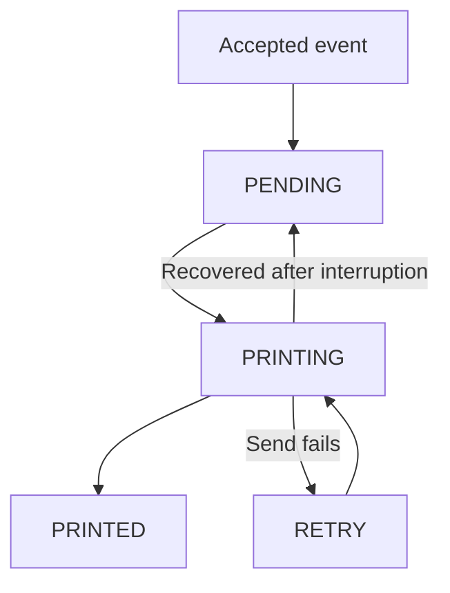

# Architecture

[Русская версия](ARCHITECTURE.RU.md) · [Project overview](../README.md)

NotiPrint separates event capture from printing. Event receivers write to Room, while WorkManager starts queue processing. A shared lock coordinates every printer connection and the database transitions around it.

## Event capture and local storage

[SmsReceiver](../app/src/main/java/ru/notiprint/receivers/SmsReceiver.kt) receives carrier SMS directly and combines multipart messages. It applies the sender blacklist and optional unknown-number filter, resolves a contact name when permitted, then stores the event. Alphabetic Sender IDs remain eligible under the unknown-number filter.

[NotiPrintNotificationListenerService](../app/src/main/java/ru/notiprint/notifications/NotiPrintNotificationListenerService.kt) handles missed calls and calendar events. It can also accept SMS notifications when direct SMS permission is unavailable. Classification uses Android categories, with phone-package, channel, and wording fallbacks for missed calls. Own notifications and group summaries are ignored.

After a listener reconnect, the service scans active notifications to recover relevant events still in the notification shade. A mutex serializes its duplicate check and insert. Calendar updates with the same notification key and content within a one-minute window are suppressed. Each stored event also has a unique source key; Room ignores another insert with that key.

[PrintJob](../app/src/main/java/ru/notiprint/data/PrintJob.kt) holds the source key, kind, title, body, source package, timestamps, status, retry count, and last error. The database also stores the sender blacklist. Settings and retry backoff state live in SharedPreferences. The app declares no Internet permission, and Android backup is disabled.

## Durable queue and printer ownership

The [queue](../app/src/main/java/ru/notiprint/data/PrintJobDao.kt) selects `PENDING` and `RETRY` rows in receive-time order, up to 50 per worker. A successful batch schedules another immediate worker when work remains.

[PrinterConnectionGate](../app/src/main/java/ru/notiprint/printer/PrinterConnectionGate.kt) owns a process-wide coroutine `Mutex`. The manual diagnostic and immediate, retry, and morning workers all acquire it before using the printer.

The queue worker keeps the lock through recovery, selection, connection, and the entire batch. It restores leftover `PRINTING` rows to `PENDING` before choosing jobs. Each job becomes `PRINTING` before rendering and sending; a successful send becomes `PRINTED`. If a job fails, its `RETRY` status, attempt count, and error are saved before releasing the lock. Another worker therefore sees the final status of the previous attempt.

This order lets a new worker recover interrupted work without resetting a row that another worker is actively printing. The gate coordinates workers inside the app process; Room provides persistence across process restarts.

`PRINTED` records completion of the local send and the estimated printer drain time. If the process stops after the printer receives the bytes but before that status is saved, recovery can print another copy. The Bluetooth path sends ESC/POS data without reading a receipt acknowledgement.

## Scheduling and night interval

[PrintScheduler](../app/src/main/java/ru/notiprint/work/PrintScheduler.kt) uses three unique WorkManager chains:

| Chain | Policy | Purpose |
|---|---|---|
| Immediate | `APPEND_OR_REPLACE` | New events, startup, reconnection, and batch continuation |
| Retry | `APPEND_OR_REPLACE` | Delayed retry without cancelling an active immediate worker |
| Morning | `KEEP` | One pending wake-up at the end of the night interval |

Retry delays grow through **15, 30, 60, 120, 240, and 480 seconds**, then stay at eight minutes. A successful queue run resets the delay. Bluetooth connection/state broadcasts and app startup can request an immediate run sooner.

At the start of a worker, [NightMode](../app/src/main/java/ru/notiprint/settings/NightMode.kt) checks the local time. An active night interval schedules morning work and leaves the queue untouched. The start is inclusive and the end exclusive; intervals across midnight are supported. Equal start and end times disable the interval. The default is 22:00–08:00.

A missing printer selection or Bluetooth permission leaves stored jobs waiting. Selecting a printer or granting Bluetooth permission requests another run. A foreground service maintains an ongoing notification, requests a notification-listener rebind, and starts queue processing. The boot/Bluetooth receiver also requests service startup when Bluetooth access is available.

## Bitmap and ESC/POS transport

[NotificationBitmapRenderer](../app/src/main/java/ru/notiprint/printer/NotificationBitmapRenderer.kt) lays out the event kind, timestamp, sender/title, and body using Android fonts. The image is 384 dots wide, with four-dot horizontal insets. Large text and Cyrillic are rasterized before transport, independent of the printer's font tables.

[EscPosRasterEncoder](../app/src/main/java/ru/notiprint/printer/EscPosRasterEncoder.kt) converts the image into `GS v 0` commands. Each row occupies 48 bytes; black pixels are packed most-significant bit first. Transparent pixels stay white, and visible pixels become black below a luminance threshold of 160. Normal notifications use bands up to 128 rows high. The manual test uses 256-row bands and adds a coverage pattern.

[BluetoothPrinterClient](../app/src/main/java/ru/notiprint/printer/BluetoothPrinterClient.kt) opens an RFCOMM connection with the standard SPP UUID and sends `ESC @` to initialize the printer. It sends all bands without deliberate pauses, feeds four lines after a regular receipt, and flushes once per image. One connection serves the whole queued batch.

Before the next receipt or connection close, [PrinterDrainTiming](../app/src/main/java/ru/notiprint/printer/PrinterDrainTiming.kt) estimates remaining print time from image height and elapsed sending time. It uses 240 rows/second plus a 300 ms margin, with a wait between 300 ms and 30 seconds. This keeps a continuous raster stream while allowing the printer to consume its final bytes.

## Verification

The [development guide](DEVELOPMENT.md#automated-checks) describes unit, Room, WorkManager, build, and device checks. The 21 JVM tests cover queue recovery, serialized workers, retry, batches larger than 50, night boundaries, backoff, notification classification, and printer timing. Five Android tests exercise persisted statuses and duplicate keys, database reopening, and real WorkManager chains. A scheduling scenario drains 120 events through three workers after one initial trigger. Printer and Bluetooth checks use the device procedure.
